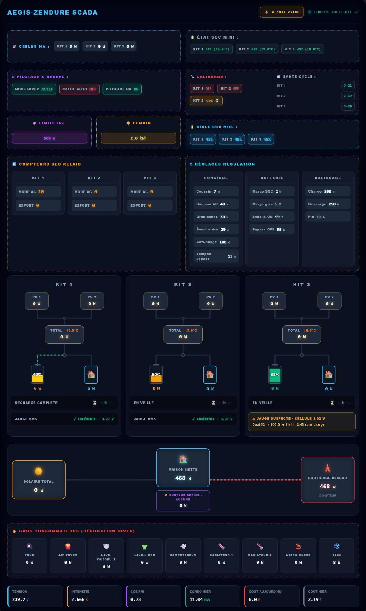

# Zendure Multi-Kit — régulation zéro export pour Home Assistant

<a href="https://buymeacoffee.com/spyker67600" target="_blank"></a>

Pilote **2 ou 3 kits Zendure SolarFlow** comme une seule installation, **100 % en local (MQTT), sans cloud**.
Le but : consommer ton solaire et tes batteries chez toi, sans rien offrir au réseau, et sans user les relais.

> 🇬🇧 **English summary** at the bottom of this page.

---

## Ce que ça fait

| Fonction | En clair |
|---|---|
| **Zéro export** | Lit ton compteur au point de livraison et ajuste la sortie des kits pour que la maison consomme exactement ce qui est produit. |
| **Solaire direct d'abord** | Le solaire part vers la maison avant de passer par la batterie (moins de pertes). |
| **Partage intelligent des batteries** | Le manque est réparti entre les kits selon leur réserve au-dessus du Min SOC (pondération au carré) : la batterie la plus pleine travaille le plus, aucune ne fait du micro-cyclage. |
| **Kit maître** | Le kit qui produit le plus couvre la maison en premier ; changement seulement avec 100 W d'écart (pas de va-et-vient). |
| **Bypass batterie pleine** | Batterie pleine : le kit passe son solaire en direct. Hystérésis réglable (99 / 95 % par défaut) contre les claquements de relais. |
| **Renfort réseau** | Quand un kit est en bypass et qu'il reste du surplus, les autres kits s'en servent pour se charger. |
| **Mode hiver** | Les gros consommateurs (four, lave-linge, radiateurs…) ne vident pas la batterie : ils restent sur le réseau. |
| **Jour gris** | Par faible soleil, une marge de SOC plus grande évite de vider la batterie pour quelques watts. |
| **Min SOC différé** | Le Min SOC n'est envoyé au boîtier qu'une fois atteint, pour ne jamais déclencher une recharge réseau payante. |
| **Calibrage LFP automatique** | Tous les N jours, charge jusqu'au **vrai** plein (tension des cellules, pas la jauge) puis décharge lente, pour recaler la jauge du BMS. Départ calculé pour finir avant le lever du soleil. |
| **Contrôle de plausibilité des jauges** | Détecte une jauge BMS qui ment (saut sans charge, jauge contredite par la tension des cellules). Le kit est alors **exclu de la décharge** jusqu'au prochain vrai plein. |
| **Sécurités** | Filet sous 6 % (recharge réseau jusqu'à 10 %), chien de garde du compteur (kits bridés à 50 W s'il tombe), exclusion automatique d'un kit muet + alerte. |
| **Tout se règle sans code** | 13 réglages dans le tableau de bord, avec des bornes qui empêchent les combinaisons dangereuses. |

---

## Prérequis

- **Home Assistant 2025.10 ou plus récent.**
- **2 ou 3 kits Zendure SolarFlow** remontés **en MQTT local** dans Home Assistant (entités `electricLevel`, `outputLimit`, `inputLimit`, `acMode`, `minSoc`, et les tensions de cellules `maxVol` / `minVol` / `batCur`).
- **Un compteur de puissance au point de livraison** (Shelly EM / Pro EM, Linky + ZLinky, etc.). Positif quand tu consommes sur le réseau.

> Testé en production sur 3 kits SolarFlow 800+ avec batteries AB2000. Le fonctionnement à **2 kits** est prévu (le 3e est simplement ignoré) mais n'a pas encore été testé en conditions réelles : retours bienvenus.

---

## Installation (résumé)

1. **Renommer** chaque appareil Zendure en `Zendure Kit1`, `Zendure Kit2`, `Zendure Kit3` et accepter le renommage des entités.
   Renommer aussi les 3 capteurs de cellules de chaque kit en `…_pack_maxvol`, `…_pack_minvol`, `…_pack_batcur`.
2. Copier `packages/zendure_multikit.yaml` dans `config/packages/` et `custom_templates/zendure_multikit.jinja` dans `config/custom_templates/`.
3. Adapter les **3 lignes marquées ⚠️ À ADAPTER** dans le package : ton compteur, tes gros consommateurs, ton téléphone (facultatif).
4. Redémarrer Home Assistant, ajouter la vue du tableau de bord, régler tes **Min SOC**, puis activer **Zendure Pilotage actif**.

## Le tableau de bord SCADA

Un synoptique animé qui montre tout d'un coup d'œil : production PV1/PV2 de chaque kit, flux vers la batterie et la maison, consignes, Min SOC, état des jauges BMS, calibrage, compteurs de relais, réglages modifiables d'un clic, échanges avec le réseau.



- Nécessite la carte **[html-template-card](https://github.com/PiotrMachowski/Home-Assistant-Lovelace-HTML-Jinja2-Template-card)** (installable depuis HACS).
- Coller `dashboards/zendure_scada_vue.yaml` dans l'éditeur de configuration brute d'un tableau de bord.
- Météo, Linky, prévision solaire et gros consommateurs sont **facultatifs** : à renseigner dans le bloc « CONFIGURATION DU SCADA » en tête de la carte. Laissés vides, ils sont simplement masqués.
- Pas de HACS ? `dashboards/zendure_multikit_vue.yaml` donne une vue simple en cartes natives.

👉 Pas à pas détaillé, avec captures des noms attendus : **[docs/INSTALLATION.md](docs/INSTALLATION.md)**
👉 Comment ça marche et à quoi sert chaque réglage : **[docs/FONCTIONNEMENT.md](docs/FONCTIONNEMENT.md)**

---

## Contenu du dépôt

```
packages/zendure_multikit.yaml          tout le système : helpers, capteurs, automatisations
custom_templates/zendure_multikit.jinja calcul des consignes (commun aux 3 kits)
dashboards/zendure_scada_vue.yaml       SCADA : synoptique animé complet (carte HACS html-template-card)
dashboards/zendure_multikit_vue.yaml    vue simple de secours (cartes natives HA, rien à installer)
docs/                                   installation, fonctionnement, dépannage
```

---

## Sécurité

La régulation ne contourne **aucune** protection du boîtier Zendure : le Min SOC est aussi écrit dans le hub, qui le respecte même si Home Assistant s'arrête, et le BMS garde ses propres limites.
Si Home Assistant plante, les kits gardent leur dernière consigne : au pire un peu d'export ou de soutirage, jamais de risque matériel.

**Utilisation à tes risques.** Vérifie que l'injection est autorisée dans ton pays et chez ton gestionnaire de réseau.

---

## Licence

**GPL-3.0** : tu peux utiliser, modifier et partager librement ce projet. Toute version modifiée que tu redistribues doit rester open source, sous la même licence, en citant l'auteur d'origine. Texte complet : [LICENSE](LICENSE).

---

## 🇬🇧 English summary

Home Assistant package that runs **2–3 Zendure SolarFlow kits** as one system, **fully local over MQTT (no cloud)**, aiming at **zero grid export**.
Solar goes to the house first; the remaining need is shared between batteries weighted by their usable charge (squared), with a "master" kit, full-battery bypass with hysteresis, winter mode that keeps heavy appliances on the grid, deferred min-SOC, automatic **LFP calibration** that detects a real full charge from **cell voltage**, a **BMS gauge plausibility check** that excludes a lying gauge from discharging, and several safety nets (low-SOC rescue, grid-meter watchdog, silent-kit alert).
All thresholds are adjustable from the dashboard. Requires Home Assistant 2025.10+, local MQTT entities for the kits, and a grid power meter.
Optional animated SCADA dashboard (needs the HACS card *html-template-card*). License: GPL-3.0.
Install: rename the Zendure devices to `Zendure Kit1/2/3`, drop the package and the Jinja file in place, edit the three `⚠️ À ADAPTER` lines, restart. Docs are in French; questions in English are welcome in the issues.
